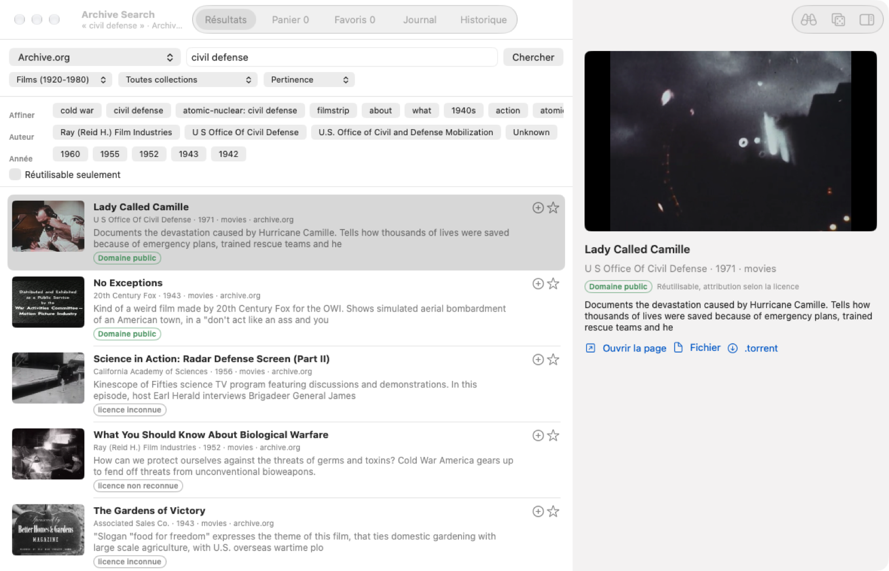
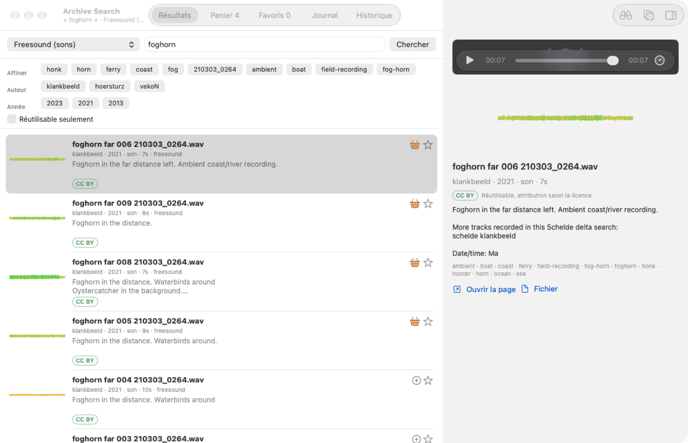
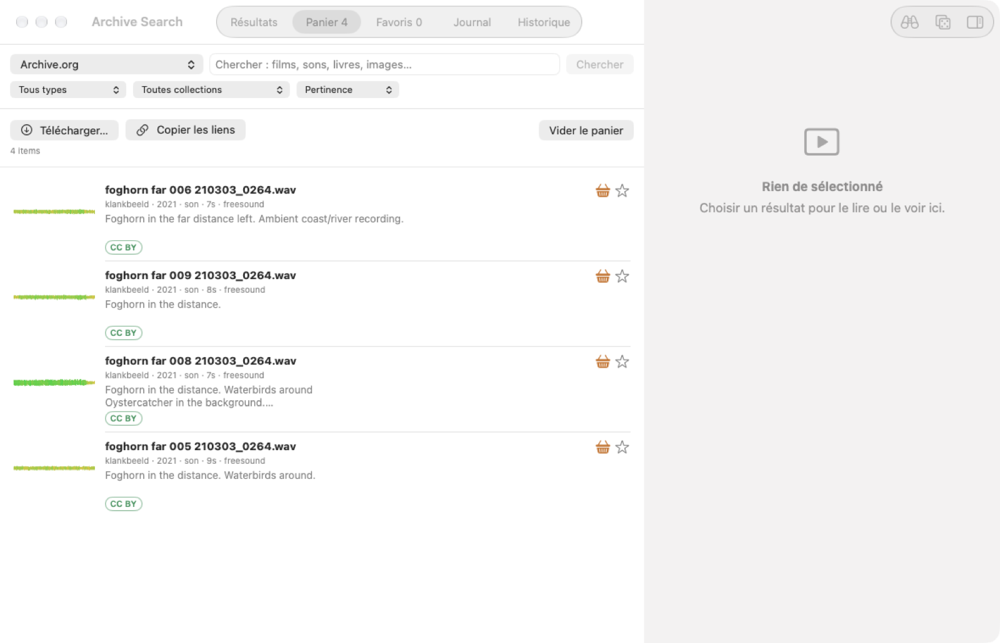
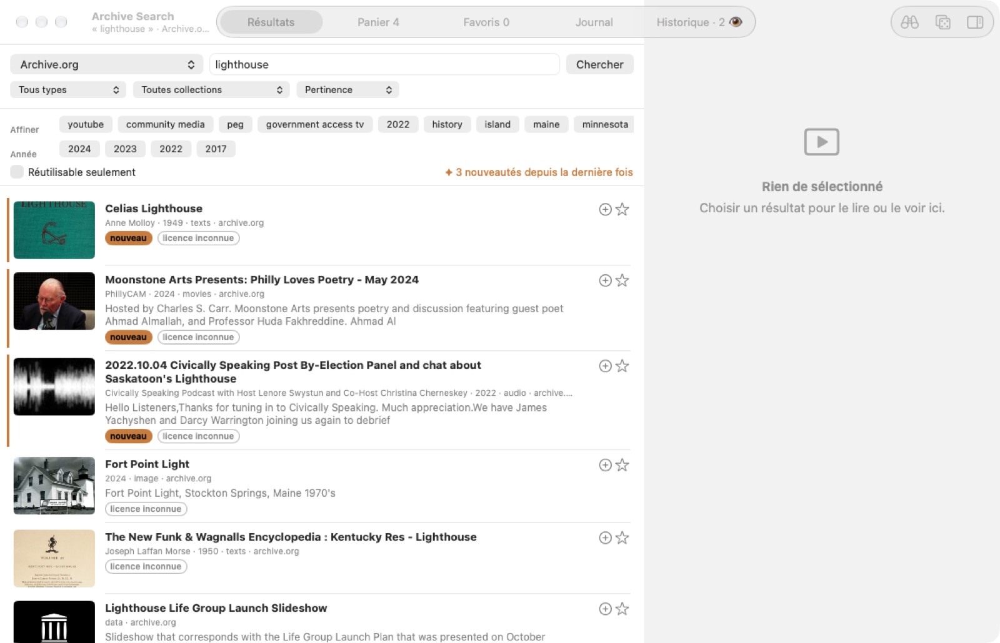
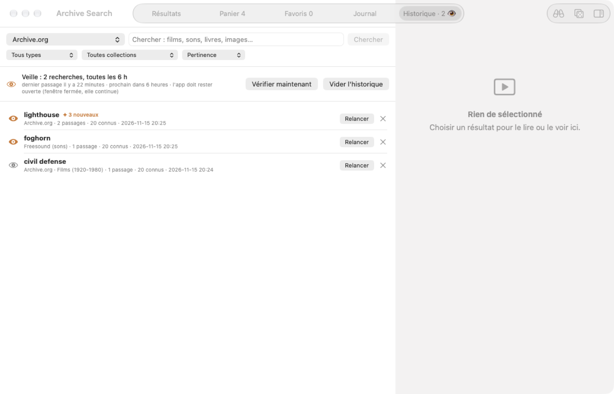
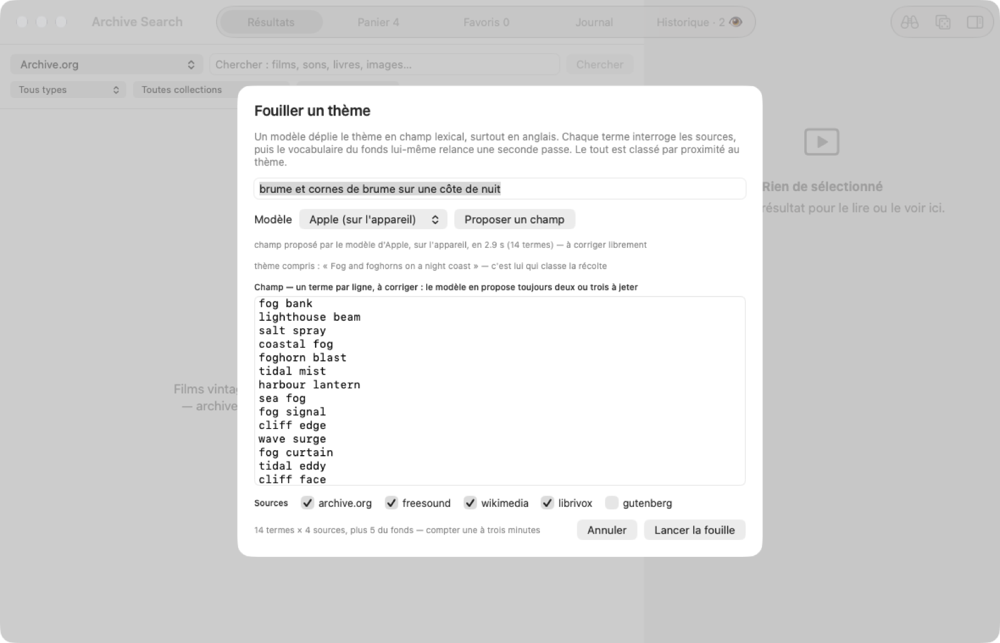
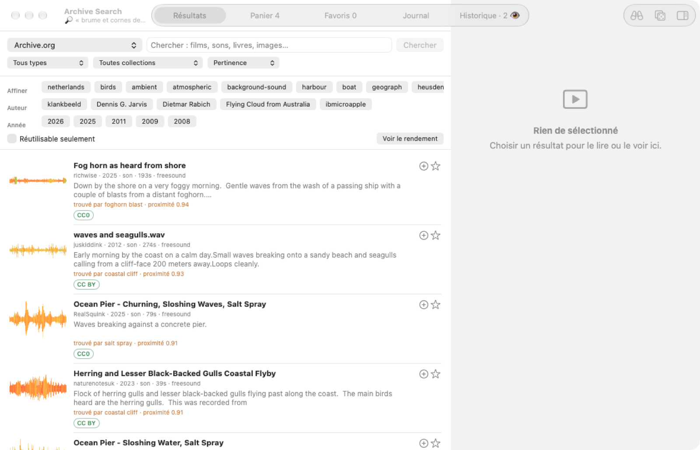
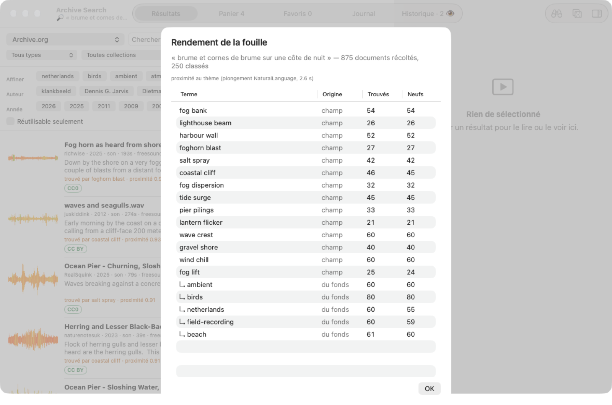

# Archive Search

Une seule barre pour chercher dans plusieurs fonds en accès libre : films
vintage, audio, livres, images. App macOS native, avec l'IA locale d'Apple
pour fouiller un thème : rien ne sort du Mac à part les requêtes aux fonds
eux-mêmes.



## Installer

macOS 26 (Tahoe) ou plus récent. Les Command Line Tools suffisent, pas besoin
d'Xcode :

```bash
git clone https://github.com/obareau/archive-search.git
cd archive-search
bash macos/build_app.sh --install      # → ~/Applications/Archive Search.app
```

Le script compile, lance l'auto-test (`archive-check`), fabrique l'icône et
signe en ad hoc. La fouille demande Apple Intelligence (Réglages Système ›
Apple Intelligence et Siri). Sans elle, tout le reste fonctionne.

## Sources

| Source | Ce qu'on y trouve | Dans l'app |
|---|---|---|
| **archive.org** | films, audio, PDFs, avec des collections (Prelinger, radio vintage, TV classique…) | liste, lecteur, panier, `.torrent` |
| **Freesound** | sons, bruitages, prises de terrain | liste, lecteur, panier, **clé requise** |
| **Wikimedia Commons** | images et médias libres | liste, image en grand |
| **Gutenberg** | livres du domaine public | liste |
| **LibriVox** | livres audio lus par des bénévoles | liste |
| **Library of Congress** | leur fonds audio | **renvoi** vers leur site, voir plus bas |

### Freesound demande une clé

Leur API n'a aucun quota anonyme. En créer une (gratuite) sur
<https://freesound.org/apiv2/apply/> et la coller dans les Réglages (⌘,). Elle
est rangée dans `~/Library/Application Support/Archive Search/freesound-token`,
lisible par toi seul. `$FREESOUND_TOKEN` prime si elle est posée.

Sans clé, la source répond par un message qui le dit, plutôt que par zéro
résultat, qu'on confondrait avec « rien trouvé ».

### Les fichiers d'origine demandent de connecter un compte

La clé seule ne livre que la **prévisualisation mp3**. Le fichier d'origine
(WAV, FLAC, AIFF…) exige OAuth2, au nom d'un compte. Dans les Réglages,
section « Fichiers d'origine » :

1. renseigner l'identifiant client de l'application (même page que la clé) ;
2. **Autoriser chez Freesound ↗** : la connexion se fait dans le navigateur,
   chez Freesound, aucun mot de passe ne passe par l'app ;
3. Freesound renvoie vers l'adresse de retour déclarée pour l'application, avec
   `?code=…` : copier cette adresse (⌘L, ⌘C), puis **Coller l'adresse de retour
   et valider**. Le code ne vaut que 10 minutes.

Le jeton se renouvelle seul. Sans compte connecté, les sons partent en aperçu
mp3, et le bilan du lot le dit, son par son. Un aperçu pris avant la connexion
ne remplace pas l'original : le lot suivant va chercher le WAV.

## Chercher



**Toutes les sources** (le choix par défaut) interroge archive.org,
Freesound, Wikimedia, LibriVox et Gutenberg en parallèle. Les résultats
s'affichent dès la première réponse, intercalés source par source pour
qu'aucune n'occupe tout l'écran. Une pastille par source dit ce qu'elle a
rendu ; un clic n'affiche que celle-là. Gutenberg, qui met 15 à 30 s, complète
la liste à son arrivée sans faire attendre les autres, et une source en panne
est signalée sans rien bloquer.

**Filtres côté source**, sous la barre : pour Freesound, la durée, le tempo et
« CC0 seulement » ; pour archive.org, la décennie. C'est la source elle-même qui
filtre : chaque page ramène vingt résultats qui conviennent, là où la case
« réutilisable seulement » ne trie que les vingt reçus. Une recherche filtrée
est une recherche à part dans l'historique, et la veille la relance avec ses
filtres.

Un résultat sélectionné se lit dans le panneau de droite : film ou audio
d'archive.org, aperçu Freesound, PDF, image Wikimedia. Pour archive.org, le
panneau donne aussi le lien du fichier et le `.torrent`.

Pour un son Freesound, le panneau donne aussi **Sons similaires** (proximité
acoustique calculée par Freesound, aussi dans le menu contextuel), ainsi que le
**tempo et la tonalité estimés**.

⚠️ Freesound calcule ce tempo et cette tonalité pour **tous** les sons, même sans
rythme ni note : une corne de brume « à 108 BPM, do mineur ». L'app les marque
comme estimés, et ne les affiche sur les lignes que si l'on filtre par tempo.

Sous la barre, trois familles de **propositions connexes**, tirées des
résultats déjà obtenus. Elles ne coûtent aucun appel réseau de plus, et marchent
aussi pour les sources sans API de suggestion :

- **Affiner** : mots-clés récurrents (`subject` d'archive.org, `tags` de
  Freesound, mots des titres ailleurs) ;
- **Auteur** : contributeurs qui reviennent ;
- **Année** : pour rester dans une époque.

Un clic relance la recherche sur la **même source**.

⚠️ Deux filtres appris en testant : un terme vu une seule fois sur vingt
résultats n'est pas un thème (seuil à 2), et les horodatages des descriptions
archive.org (`00am`, `01pm`) sont écartés, mais pas `16mm` ni `super8`, qui
sont de vrais termes pour un fonds film.

### Licences

Chaque résultat porte sa licence : **vert** réutilisable, **rouge** restrictif,
**gris** inconnu. Une licence `by-nc-nd` interdit la modification : un son sous
cette licence ne peut pas entrer dans un morceau publié. La case « réutilisable
seulement » masque le rouge **et** le gris, et dit combien de cartes sont
cachées.

⚠️ **« Inconnu » n'est pas « libre ».** C'est le cas le plus fréquent sur
archive.org : sur une recherche `prelinger`, 1 réutilisable, 3 restreints et
**16 inconnus** sur 20. Un fonds en accès libre n'est pas un fonds libre de
droits.

## Projets, téléchargement, crédits



**Un panier par projet** (« Robōtariis ép. 12 », « Séance AZA 14 ») : le
sélecteur en tête du panier change de projet, le menu à côté en crée, en
renomme, en supprime. ➕ ajoute au projet actif. Chaque projet retient son
dossier de téléchargement : le dialogue s'y rouvre, et sa fiche de crédits s'y
complète. **Copier les crédits en Markdown** donne la liste titre, auteur,
source et licence, prête pour des notes d'épisode ou le vault.

**⬇ Télécharger…** ouvre le dialogue de dossier de macOS. Choisir la racine
(`~/archive-search-downloads`) range le lot dans un sous-dossier daté
`<AAAA-MM-JJ_HHMM>/<source>/`. Chaque fichier s'écrit en `.part`, renommé à la
fin : rien d'incomplet ne porte le nom final. Une erreur réseau est retentée
trois fois, un refus de la source (4xx) ne l'est pas. Un lot s'arrête en cours
sans rien laisser d'incomplet.

⚠️ **Seules archive.org et Freesound donnent un vrai fichier.** Gutenberg,
Wikimedia et LibriVox ne renvoient qu'une page web : ces items sont écartés, et
le bilan du lot dit lesquels et pourquoi.

**Copier les liens** met un lien par ligne dans le presse-papiers : le
`.torrent` d'abord pour archive.org, sinon le fichier, sinon la page.

### Journal des téléchargements

Chaque fichier écrit est noté, avec **tous** les endroits où il a été rangé. Une
carte dont le fichier est encore sur le disque porte **déjà pris**.

**Glisser la vignette** d'un son ou d'un film vers Logic, Ableton ou le Finder
y dépose le fichier lui-même : celui du disque s'il est déjà pris, sinon il est
téléchargé au moment du dépôt (l'original Freesound si le compte est connecté).
Seules les sources sans fichier (Gutenberg, Wikimedia, LibriVox) se glissent
comme lien vers leur page.

| Situation | Ce qui se passe |
|---|---|
| le fichier est déjà dans le dossier choisi | rien, le bilan le signale |
| il est ailleurs sur le disque | **copie locale**, sans réseau |
| il a été effacé ou déplacé à la main | téléchargement normal |

⚠️ Le doublon n'est pas refusé : le même son sert à deux projets rangés dans
deux dossiers. C'est la **destination** qui décide, pas la présence dans le
journal. N'en retenir qu'un chemin faisait recopier un fichier dans le dossier
qui le contenait déjà, avec un doublon `(1)` que rien n'expliquait.

### Fiche de crédits

Chaque lot ajoute un `CREDITS.txt` dans son dossier : titre, auteur, source,
URL, licence. Les licences en « BY » **imposent** de créditer. Un item dont la
licence n'est pas franchement réutilisable porte un `⚠` avec la raison.

⚠️ **Ajout, jamais écrasement** : un second lot dans le même dossier n'efface
pas l'attribution du premier, et un fichier déjà crédité n'est pas crédité deux
fois.

## Nouveautés et veille



Chaque recherche est datée, avec les identifiants déjà vus. La relancer met en
avant ce qui est **apparu depuis la dernière fois** : liseré ambre, badge
« nouveau », et les nouveautés en tête de liste.

⚠️ Une recherche **inédite** ne signale rien comme nouveau : tout l'est, et
badger vingt résultats sur vingt n'apprend rien. La nouveauté commence au
deuxième passage. Le compteur ne bouge qu'en page 1, sinon feuilleter trois
pages le gonflerait sans qu'il soit rien arrivé.



L'œil met une recherche **sous veille** : un passage toutes les 6 h tant que
l'app tourne, et une notification macOS **seulement s'il y a du neuf**. Un clic
sur la notification rouvre la recherche. Avec une veille active, fermer la
fenêtre ne quitte pas l'app (⌘Q la quitte). Si le Mac était éteint à l'heure
prévue, le passage manqué se fait au lancement suivant.

Tant qu'une recherche est sous veille, des **jumelles** s'affichent dans la
barre des menus (pleines s'il y a du neuf). Leur menu liste les recherches
surveillées avec leurs nouveautés ; un clic rouvre la recherche, même fenêtre
fermée. On y trouve aussi « Vérifier maintenant ».

Les recherches sont espacées de 20 s : six requêtes d'affilée ressemblent à du
moissonnage et finissent limitées. Une source en panne est notée, elle
n'arrête pas la veille des autres et ne déclenche aucune notification.

## Fouiller un thème (⇧⌘F)

Une recherche ordinaire pose **une** question. Fouiller, c'est en poser vingt
et recouper. On part d'un thème en clair, par exemple « brume et cornes de
brume sur une côte de nuit ».



**Deux passes, et la seconde est celle qui compte.** Le modèle d'Apple
Intelligence (sur l'appareil) déplie le thème en champ lexical, en anglais,
parce qu'un terme français ne ramène presque rien de ces fonds. Le champ est
**modifiable avant de lancer** : le modèle en propose toujours deux ou trois à
jeter. Puis la récolte est relue pour en tirer le vocabulaire **du fonds
lui-même**, qui relance une seconde passe.



La récolte est classée par **proximité au thème** (plongement NaturalLanguage,
local), avec le thème traduit en anglais comme requête. La centralité, c'est-à-dire
le nombre de termes du champ qui ont ramené un document, ne sert qu'à départager.
Une licence réutilisable et un vrai fichier ajoutent quelques points, et **ce qui
est déjà pris est rétrogradé** : on fouille pour du neuf.



**Voir le rendement** dit quels termes ont donné et lesquels n'ont rien rendu.
Sans ça, le champ du modèle reste invérifiable.

### Le modèle et le classement, mesurés

Sur « brume et cornes de brume sur une côte de nuit », le 2026-11-15 :

| | Version web (Ollama) | App native |
|---|---|---|
| champ lexical | `llama3.1:8b`, 5,7 s à chaud | modèle d'Apple, 1,4 à 3 s |
| classement de 250 documents | `nomic-embed-text`, ~22 s | NaturalLanguage, 2,7 à 3,9 s |
| écart de proximité haut/bas | 0,252 | 0,276 |

⚠️ **La requête de classement est le thème traduit**, pas le champ. Le champ
du modèle d'Apple porte son bruit (« kerosene tank ») et faisait monter un jet
« Skyhawk Tank » au 7ᵉ rang. Le thème laissé en français est le pire (écart
0,180, « Salt Spray » en tête), déjà constaté avec nomic.

⚠️ **Seuls les termes du champ comptent pour la centralité.** Les termes du
fonds élargissent la récolte, mais n'attestent pas qu'un document est dans le
thème : « netherlands », tiré du fonds, faisait passer trois prises de vent sur
la Meuse (proximité 0,89) devant « Fog horn as heard from shore » (0,94).

⚠️ La pesée (proximité ×14, centralité ×1) est **mesurée, pas choisie** : à 10
et 2, un document trouvé par deux termes passait devant un foghorn 0,2 plus
proche du thème. L'auto-test fige cet ordre.

### Ce que la fouille se refuse

- **Gutenberg est hors du lot par défaut** : 15 à 30 s la requête, il mangerait
  sept minutes à lui seul. Il reste coché à la main.
- **Une fouille à la fois**, et 1,2 s entre deux requêtes.
- **Rien n'est écrit dans l'historique** : une fouille de quinze termes y
  créerait quinze entrées et enterrerait un mois de recherches.
- **Rien ne part au panier tout seul** : deux cents résultats déversés dedans
  détruiraient une sélection faite à la main.
- Une source qui tombe **sort de la rotation**, et le rapport le dit une fois.
- Si Apple Intelligence est désactivé ou refuse un thème (garde-fous), la
  feuille le dit, et le champ se réduit au thème, à compléter à la main. Un
  modèle Ollama est proposé s'il en tourne un.

## Pourquoi certaines sources font exception

### Gutendex est lent

Mesuré le 2026-10-10 : 15 à 30 s par requête, et une page d'erreur HTML sous
charge. Un délai de 10 s le déclarait mort alors qu'il travaillait. D'où un
délai de 30 s pour cette source seulement (l'allonger pour toutes ferait
patienter une minute sur une vraie coupure d'archive.org), et un message
lisible quand la réponse n'est pas du JSON.

### La Library of Congress n'est qu'un renvoi

`loc.gov` place l'ensemble de son site derrière un défi JavaScript (Cloudflare)
et répond **403 à tout programme**, y compris sur sa propre page de
documentation d'API. Un navigateur passe ce défi, pas l'app. La recherche
s'ouvre donc chez eux, dans le navigateur. Le fonds `library_of_congress`
d'archive.org ne comble pas le manque : c'est du texte numérisé, pas leur audio.

## Apparence

Réglages (⌘,) › **Apparence**, les mêmes que dans AZA :

- **taille du texte** de 80 à 180 %, aussi par ⌘+, ⌘− et ⌘0 (menu Présentation) ;
- **police** : SF Pro, SF Mono, Menlo, ou IBM Plex Mono si elle est installée ;
- **titres en monospace**, **interface compacte** ;
- **thème** : Système, Béton, Machine, Nord, Solarized clair et sombre,
  Gruvbox, ou personnalisé (fond, texte, accent, bordure). L'accent du thème
  remplace l'ambre partout : badges, liserés, boutons.

Ces réglages vivent dans les préférences macOS, pas dans les données : ce sont
des goûts de poste.

## Données

Tout vit dans `~/Library/Application Support/Archive Search/` :
`projects.json` (les paniers par projet ; l'ancien `cart.json` y devient le
projet « Panier » au premier lancement), `favorites.json`, `history.json`,
`downloads.json`, aux formats de la version web, plus les jetons Freesound
(fichiers lisibles par toi seul). **Fichier › Importer les données de la version web…** reprend ceux de
`~/.local/share/archive-search` par fusion, sans rien écraser.

## Développement

```bash
swift run --package-path macos archive-check            # 89 vérifications, sans réseau
swift run --package-path macos archive-check --live     # + une requête par source, un vrai téléchargement
swift run --package-path macos archive-check --original # un vrai WAV Freesound (compte connecté), sur données jetables
swift run --package-path macos archive-check --hunt "brume et cornes de brume sur une côte de nuit"
```

`--hunt` déroule une vraie fouille et compare les requêtes de classement. Les
choix techniques et les pièges d'une compilation sans Xcode sont dans
[`macos/README.md`](macos/README.md). Les captures de cette page sont faites
par le mode démo de l'app (`ARCHIVE_DEMO_*`, voir
[`Demo.swift`](macos/Sources/ArchiveSearch/Demo.swift)), sans un clic simulé.

## La version web (Flask)

L'app est née en Flask, servie sur un réseau local (`app.py`, port 5556). Elle
reste dans le dépôt :

```bash
uv run app.py              # port 5556 par défaut, ou $ARCHIVE_PORT
uv run test_downloads.py   # journal + fiche de crédits
uv run test_hunt.py        # hygiène des termes + pesée du classement
```

Ses différences avec l'app native :

- **Clé Freesound** dans `FREESOUND_TOKEN`, de préférence par un drop-in
  systemd (`sudo systemctl edit archive-search`).
- **Téléchargements sur le disque du serveur**, d'où un navigateur de dossiers
  fait main : `showDirectoryPicker()` viserait la machine cliente, et n'existe
  qu'en HTTPS sur Chromium. La destination est validée côté serveur
  (`../../.ssh` est refusé).
- **Panier et favoris côté serveur**, pour suivre d'une machine à l'autre.
  Dernier écrivain gagne entre deux onglets.
- **Veille** par un thread toutes les 6 h, notifications par
  `~/scripts/notify.sh`.
- **Fouille** par Ollama (`llama3.1:8b` et `nomic-embed-text`, avec leurs
  préfixes de tâche `search_query:` / `search_document:` obligatoires), avec le
  champ comme requête de classement.
- **Le journal commence le 2026-10-11** : les lots téléchargés avant ne s'y
  trouvent pas.

## Licence

Le code est sous licence [MIT](LICENSE). Elle ne couvre que le logiciel :
chaque document trouvé avec l'app garde sa propre licence, celle qu'affiche
son badge. C'est elle qui dit ce qu'on peut en faire.
